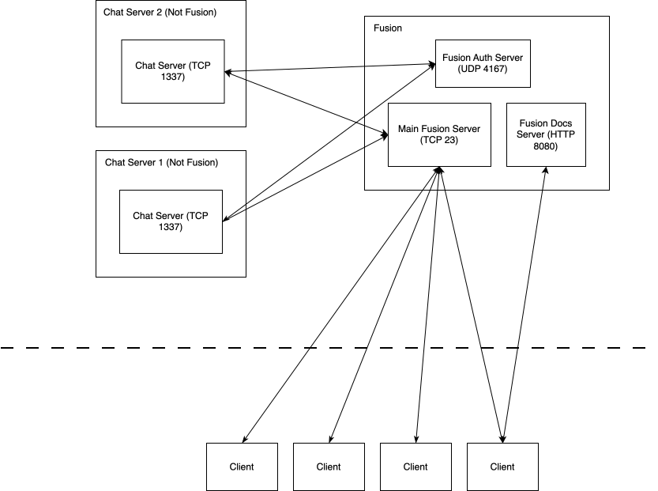

# Server Architecture

## Servers

Fusion runs multiple servers on the same ip address, with different ports.

The servers run are:

| Name         | Port | Protocol      | Purpose                                                      | Note                  |
| -------------| ---- | ------------- | ------------------------------------------------------------ | --------------------- |
| Main Server  | 23   | TCP (Netcat)  | Allows users to connect to Fusion and play the game          | Human Readable Format |
| HTTP Server  | 80   | HTTP (TCP)    | Docs and HTTP API                                            |                       |
| Auth Server  | 4167 | UDP           | Allows external services (like chat servers) to authenticate | JSON Format           |

> Note for auth server: View [External Services](./external-services.md) for details on protocal and format.

## Networking Diagram

